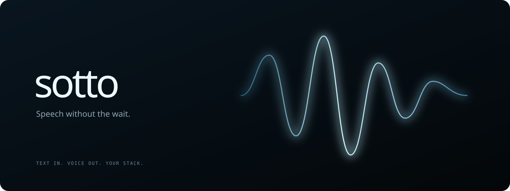
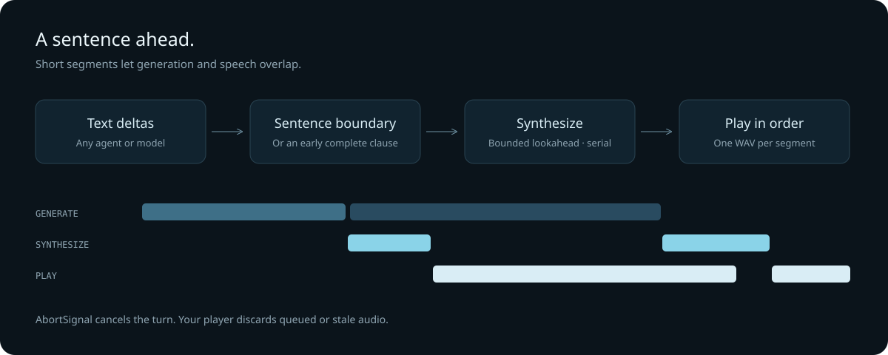

<p align="center"></p>

# Sotto

**Model-agnostic voice turns: text or a recording in, ordered speech out.**

`streamVoiceTurn` composes a complete host-supplied input, any text model
behind a small `VoiceResponder` port, and any speech engine behind a small
`SpeechSynthesizer` port into cancellable sentence audio with transcript and
pipeline callbacks. No agent framework. No provider lock-in. No mandatory
cloud service. The TypeScript core has **zero runtime dependencies**; the
optional Python runtime runs Kokoro or Breeze TTS 2 GGUF on your own GPU and
Whisper on CPU.

## Use it

Requires Node 22.19 or newer. Until an npm release is published, clone this
repository and run `npm install && npm run build`, then use `npm install /path/to/sotto-voice`
in your application. The package name is `@hffmnn/sotto-voice`.

```ts
import { streamVoiceTurn } from "@hffmnn/sotto-voice";

const controller = new AbortController();
for await (const chunk of streamVoiceTurn(
  { type: "text", text: "What time is the film?" },
  {
    responder, // your model: respond(text, { signal }) -> AsyncIterable<string>
    recognizer, // your speech-to-text, audio turns only
    synthesizer, // e.g. createOpenAiSpeechSynthesizer({ baseUrl, apiKey, voice })
    signal: controller.signal,
    onTranscript: (t) => captions.show(t),
    onState: (phase) => presence.show(phase), // transcribing | thinking | speaking
  },
)) {
  // chunk.data is a complete PCM16 WAV. Queue it on your audio player.
  // chunk.text, chunk.index and chunk.synthesisMs support captions and timing.
  await player.enqueue(chunk.data);
}

// Call this on interruption, dismiss, or the start of a replacement turn.
controller.abort();
```

Full port signatures, defaults, transcript and cancellation semantics are in
[docs/api.md](docs/api.md). Spoken-answer prompt policy ships as two exports:
`AGENT_VOICE_INSTRUCTIONS` (the full startup policy, canonical source in
[skills/agent-voice/SKILL.md](skills/agent-voice/SKILL.md)) is appended once to
your model's system instructions, while `TURN_INJECTION_INSTRUCTIONS` (the tiny
recurring reminder, canonical source in
[skills/turn-injection/SKILL.md](skills/turn-injection/SKILL.md)) is injected as
trusted host context on every model request. Host integration guidance for
developers adding Sotto to their own application is in
[skills/sotto-development/SKILL.md](skills/sotto-development/SKILL.md).

`player` is your application's audio output, not a Sotto API. Keep its own
playback queue bounded: returning immediately from `enqueue` without a limit
defeats any upstream backpressure.

Your application owns microphone consent, voice activity detection, audio
focus, playback, durable conversation and agent tools. Sotto never inserts
filler, never captures audio, and knows nothing about tool permissions.

## How it flows



`streamVoiceTurn` transcribes audio input (text input skips this), streams the
model reply through `segmentText()`, and synthesizes one sentence at a time
while reading a small number of future sentences. Consumer backpressure bounds
lookahead; cancellation stops future work and discards late audio even if a
provider ignores its signal.

Need the text stream without the turn wrapper? `streamSpeech()` takes your own
`AsyncIterable<string>` plus a synthesizer and yields the same ordered chunks:

```ts
import { createOpenAiSpeechSynthesizer, streamSpeech } from "@hffmnn/sotto-voice";

const apiKey = process.env.SOTTO_API_KEY;
if (!apiKey) throw new Error("Set the runtime's SOTTO_API_KEY");
const synthesizer = createOpenAiSpeechSynthesizer({
  baseUrl: "http://127.0.0.1:8935/v1",
  apiKey,
  voice: "af_heart",
});

async function* reply() {
  yield "Let me check that. ";
  yield "The film starts at eight.";
}

for await (const chunk of streamSpeech(reply(), { synthesizer, signal: controller.signal })) {
  await player.enqueue(chunk.data);
}
```

For a Q4 Breeze-configured runtime, set `model: "breeze-tts-2-q4_k"` and
`voice: "breeze"` when creating the synthesizer. The generic adapter retains its
Kokoro defaults for existing clients; model selection is explicit.

This is **sentence streaming**, not phoneme-level or audio-token streaming.
The WAV adapter collects the whole short segment before Sotto yields it, even
when the underlying model supports native audio streaming. That distinction
matters when comparing time-to-first-audio numbers.

## Controls

| Option | Default | Purpose |
| --- | --- | --- |
| `maxCharacters` | 240 | Split long unpunctuated utterances at a nearby space |
| `clauseCharacters` | 80 | Allow an early comma/semicolon boundary |
| `maxPendingSentences` | 2 | Bound text lookahead; synthesis remains serial |
| `signal` | — | Cancel source consumption and active synthesis |

Bring another speech engine by implementing this interface:

```ts
interface SpeechSynthesizer {
  synthesize(text: string, options: { signal: AbortSignal }): Promise<{
    data: Uint8Array;
    mimeType: "audio/wav";
  }>;
}
```

The OpenAI-compatible adapter rejects redirects, credential-bearing URLs, oversized
responses and malformed/non-PCM WAV audio. It imposes a timeout and does not include
provider response bodies or secrets in errors.

## Local speech

See [the runtime guide](runtime/README.md). The optional service provides:

- Kokoro-82M, stock voices, CUDA or an explicitly selected CPU device.
- Optional Breeze TTS 2 Q4_K or Q8_0 through a pinned Vulkan C++ runtime, with a reference-free
  designed voice. Its research/non-commercial model license is separate from this code.
- Whisper small/int8 on CPU, leaving GPU headroom for speech synthesis.
- OpenAI-compatible speech and transcription endpoints on loopback with bearer auth.
- One inference at a time, bounded admission, recording/text limits and no transcript logs.

### A measured reference, not a promise

On an RTX 4050 Laptop GPU with 6 GB VRAM, Kokoro 0.9.4 / `af_heart` generated
a 93-character utterance (5.725 seconds of audio) in **152 ms warm**. Its first
model chunk arrived at 150 ms. Peak PyTorch CUDA allocation across the two-utterance
probe was **658 MiB**. Cold first inference took **2.744 seconds**, after a separate
3.058-second model load. Warm the model before accepting a conversation.

These are local synthesis measurements, not microphone-to-speaker latency, and
CUDA allocation excludes driver/runtime overhead. Model quality is subjective;
no claim is made that the smallest model tops the quality leaderboard. See
[model selection and sources](docs/models.md).

A second real service probe on an RTX 3070 Ti (8 GB) used about **898 MiB** of
process GPU memory. Through Sotto's TypeScript adapter over loopback HTTP, the
first short sentence arrived in **107 ms**, and two sentences completed synthesis
in **200 ms** total. CPU/int8 transcription of the second synthetic sentence took
**1.058 seconds** and returned its words correctly. These figures still exclude
LLM reasoning, microphone capture, network-to-TV delivery and playback. They are
not a claim of a live conversational round-trip.

On the same RTX 3070 Ti, the optional **Breeze TTS 2 Q4_K** service produced
3.36 seconds of audio in **1.078 seconds** through the same WAV adapter after
representative startup warmup. CPU Whisper returned the exact synthetic words
in 1.243 seconds. The service process used 2,683 MiB of GPU memory after the probe;
that is an observed allocation, not a worst-case peak. Kokoro took 214 ms for the
same text in the comparison, so Q4 trades some latency for a different voice model.
These single probes do not establish general quality, p95 latency, or real conversation.

## Conversation without the theatre

Let the agent choose a short acknowledgment when it actually needs to look
something up. Speak it as an ordinary first sentence. Do not prepend “Hmm” to
every answer, invent fake progress, or keep talking over the user. Sotto never
inserts filler automatically and knows nothing about tool permissions.

Neither Pi nor ADB belongs in this package. There is no always-on recorder,
voice cloning or telemetry.

## Development

```sh
npm install
npm run typecheck
npm test
```

The focused tests cover early synthesis, bounded lookahead, ordering, cancellation,
segmentation, and the real HTTP adapter contract. Runtime route tests use a fake
engine; they do not establish model quality or CUDA compatibility.

## License

MIT for this code and original diagrams. Kokoro weights are Apache-2.0;
Whisper/faster-whisper have their own MIT licenses. Breeze C++ code is Apache-2.0,
but Breeze weights and self-hosted outputs are research/non-commercial only.
Models and their licenses are not bundled or relicensed by Sotto. See [LICENSE](LICENSE).
